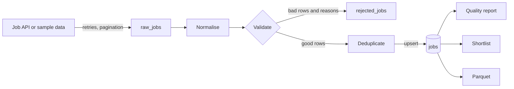

# Job feed ETL

[](https://github.com/aman25singh/job-feed-etl/actions/workflows/ci.yml)

[](LICENSE)

**An incremental pipeline that turns a messy job-board API into a clean, deduplicated DuckDB table
and a shortlist of roles worth applying to.**

I started this to help with my own job applications: job feeds repeat themselves, drop fields and
repost the same role under new links. The first version was a single script I never finished. This
is the rebuilt pipeline.



## Features

- **Incremental and idempotent:** re-running a batch changes nothing in `jobs`. Each job keeps
  `first_seen_at` and `last_seen_at`, and a late, older snapshot can't overwrite newer values.
- **Deterministic IDs:** a SHA-256 key built from link, title and company, stable across runs.
- **Two kinds of duplicates:** repeated records are dropped on load. Reposts under new links are kept
  but collapsed by a window-function view.
- **Quarantine:** invalid rows go to `rejected_jobs` with their reasons instead of disappearing.
- **All or nothing:** each batch loads in one transaction, after the whole feed has been read.
- **Polite API client:** capped retries with backoff, `Retry-After` support, and no retry on
  authentication errors.
- **Clean salaries:** hourly, daily, weekly and monthly pay becomes annual. Unknown periods are left
  empty, not guessed.
- **Offline demo:** generated sample data with realistic faults, so no API key is needed.

## Setup

```bash
git clone https://github.com/aman25singh/job-feed-etl.git
cd job-feed-etl
python -m venv .venv && source .venv/bin/activate   # Windows: .venv\Scripts\activate
pip install -e ".[dev]"
```

## Run the demo

```bash
jobfeed run --sample --day 1
jobfeed run --sample --day 1      # again, to see that nothing is added
jobfeed run --sample --day 2
jobfeed run --sample --day 3
jobfeed report
jobfeed shortlist --keyword engineer --remote --min-salary 140000 --limit 3
jobfeed export
pytest
```

Output of the four runs:

```text
fetched=126  rejected=8  duplicates=3  inserted=115  seen_again=0  total=115
fetched=126  rejected=8  duplicates=3  inserted=0  seen_again=115  total=115
fetched=255  rejected=13  duplicates=8  inserted=119  seen_again=115  total=234
fetched=392  rejected=20  duplicates=14  inserted=124  seen_again=234  total=358
```

Shortlist (generated data, fictional companies):

```text
2026-01-17  Analytics Engineer at Northwind Capital
            Remote  |  $150,000 to $180,000  |  https://jobs.example.com/30077
2026-01-17  Machine Learning Engineer at Fennel Capital
            Remote  |  $141,000 to $171,000  |  https://jobs.example.com/30046
2026-01-17  Machine Learning Engineer at Orbit Logistics
            Remote  |  $112,320 to $143,520  |  https://jobs.example.com/30002
```

`--min-salary` compares against the top of the advertised range. The full quality report is in
[`reports/sample_report.md`](reports/sample_report.md).

## Run on live data

Copy `.env.example` to `.env`, add a [Fantastic.jobs](https://fantastic.jobs/api) API key, then:

```bash
jobfeed run --query "data engineer" --location "United States" --time-frame 24h --limit 300
```

The field mapping follows the vendor's published documentation. Responses are tested with stubs; the
live endpoint has not been exercised in this version. No real postings are stored in this repository.

## Data model

| Table | Grain | Purpose |
|---|---|---|
| `raw_jobs` | one row per fetched record | Untouched JSON, for replay and debugging |
| `rejected_jobs` | one row per invalid record | JSON plus a list of reasons |
| `jobs` | one row per `job_uid` | Clean, typed, upserted |
| `runs` | one row per batch | Audit counts |
| `unique_roles` | one row per title, company and location | View that hides reposts |

Every run reconciles: `fetched = rejected + duplicates + inserted + seen_again`.

## Layout

```
src/jobfeed/
  sources.py     API client and sample generator
  transform.py   schema mapping, IDs, deduplication (pure functions)
  quality.py     validation rules
  store.py       DuckDB schema, upsert, queries
  pipeline.py    one batch, end to end
  report.py      Markdown quality report
  cli.py         command line
tests/           offline test suite with the network blocked
```

## Limitations and next steps

- Salaries in other currencies are stored as quoted, so `--min-salary` doesn't convert them.
- The job ID includes the link, so an edited title creates a new row.
- Raw records are kept forever. A retention policy would be needed for daily use.
- Not built yet: scheduling, application tracking and visa filters.

## Stack

Python, DuckDB, SQL, Requests, Parquet, pytest, Ruff, GitHub Actions.
